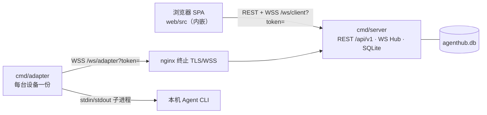

# AGENTS.md

> 给 coding agent 的项目速查。动手改代码前先读 §1 硬约束、§5 不变量、§8 常见陷阱。
> 设计与契约的**唯一权威文档就是本文件**（原 docs/00~04 的有用内容已归纳于此并删除）；部署与配置见 `README.md`。

## 1. 项目定位与硬约束

把分散在 Windows / Linux / WSL 上、协议各异的 AI Agent 集中到一个网页里统一注册、统一对话。本期**只做连接注册 + 单 Agent 会话**，不做团队 / 工作区 / 任务派发 / 计费 / 多租户。

| 约束 | 落地方式 |
| --- | --- |
| 两个单二进制 | `cmd/server`（内嵌前端 + SQLite）与 `cmd/adapter`，各自一个可执行文件 |
| **禁止 CGO** | 全仓 `CGO_ENABLED=0`；SQLite 用 `modernc.org/sqlite`；Windows 进程树用 `golang.org/x/sys/windows` 纯 Go syscall |
| 无外部依赖 | 不要 Redis / Docker / PostgreSQL / 消息队列 / 独立前端 Node 进程 |
| 前后端分离 | 前端只通过 `/api/v1` REST + 2 条 WS 与后端交互；构建产物由 Go `embed` 内嵌 |
| 移动端适配 | `md`(768px) 唯一主断点；375px 无横向滚动、点击目标 ≥44px、输入区避让 safe-area |
| 构建环境 | Go **≥1.26**、Node 22、**npm**（不用 pnpm） |

依赖固定：`modernc.org/sqlite v1.61.1`、`gorilla/websocket v1.5.3`、`golang.org/x/sys v0.49.0`、`google/uuid v1.6.0`。`go.mod` 的 `go 1.26.0` 由依赖链强制，不要降级。

## 2. 架构



- **两条独立 WS 通道**：`/api/v1/ws/client`（登录 token）与 `/api/v1/ws/adapter`（设备令牌，`server.device_token`）。浏览器 WS 不能自定义 header，握手统一 `?token=`；REST 用 `Authorization: Bearer`。
- **登录密码与设备令牌彻底分离**，禁止互相复用。
- **`resume_id` 只存平台 `sessions` 表**，适配器完全无状态（本地只持久化 `device_id`）。

## 3. 目录结构

```
cmd/server/main.go          平台服务装配（配置→store→HTTP→signal ctx）
cmd/adapter/main.go         适配器装配（config→device_id→发现→WS→Backend）
pkg/protocol/               ★ 跨端共享协议：帧信封、F01~F15、payload、错误码、Agent 类型
internal/config/            ServerConfig / AdapterConfig，含默认值与校验
internal/server/            平台后端
  store.go dto.go           SQLite 迁移(5表) / REST DTO + 统一包络
  server.go middleware.go   路由、静态资源、鉴权中间件
  auth.go                  不透明 token（SHA-256 入库、24h、登出吊销）
  hub.go conn.go           WS 连接表、双泵 goroutine、trySend、离线扫描
  ws_adapter.go ws_client.go  两条通道握手与帧分派
  chat.go                  ★ 对话编排：tryBegin、seq 分配、流式缓冲、终态落库
  repo_*.go handler_*.go   数据访问 / REST 端点
internal/adapter/           设备侧适配器
  registry.go              ★ 9 行 Agent 描述符表（新增 Agent 只改这里）
  backend.go session.go    ★ Backend/Session 四件套、SessionManager 单活跃 turn
  discover.go version.go   四级自动发现 + 版本探测
  launcher.go scanner.go   进程构造、32MiB NDJSON、stdin 写 prompt
  proto_stream.go          S 族 stream-json（fail-closed）
  proto_acp.go             A 族 ACP / AS 族 app-server 共用 RPC 内核
  proto_appserver.go       AS 族差异配置
  proto_json.go            J 族 opencode 行式 / openclaw 整块 + idle grace
  resume.go                ★ BuildResume 5 种写法、ClassifyResumeFailure
  proc_windows.go proc_unix.go  build tag 分流，进程树级清理
  wsclient.go              注册快照、15s 心跳、退避重连
web/src/                    React 18 + TS + Tailwind 3（无 MUI、无状态管理库）
  api/{client,types}.ts    fetch 封装 / DTO 与帧类型镜像
  ws/ClientWS.tsx          WS Provider：seq 去重、chunk 拼接、since_seq 补齐
  pages/                   Login / Devices / Discover / Agents / Chat
scripts/smoke.sh            端到端冒烟（真实 server + 假 CLI）
scripts/check-web.sh        交付前置校验：dist 必须是真实 SPA
docs/                       openapi.yaml（REST 契约，见 §5 不变量 6 的四方同步）
```

## 4. 核心数据流（一次对话）

```
浏览器 chat.send{agent_id, content}
  → 平台 chat.go: tryBegin 原子占位 → EnsureSession → AppendTurn 分配会话级 seq
      预插 assistant(status=streaming) 占位 → 补齐 session_id/resume_id/user_seq/assistant_seq
  → 转发完整帧给该 agent 所在设备的 WS 连接
  → 适配器 SessionManager.runTurn: Backend.Execute → 启动/恢复 CLI（prompt 走 stdin）
  → 解析器流式 Message → chat.chunk{chunk_index} → 平台内存缓冲 → 浏览器逐字渲染
  → Result → chat.done{completed, resume_id} → 平台一次性 UPDATE 完整文本落库
```

停止生成 / 取消注册 / 超时都走 `cancel()` → `KillTree()`；失败气泡展示 `done.error` 真实原因。

## 5. 不可破坏的不变量

| # | 不变量 |
| --- | --- |
| 1 | **三态独立**：`discovered`（行存在）/ `registered`（用户勾选、持久化）/ `online`（WS+心跳推导）。任何写路径不得互相推断；进程启动把所有 `online` 重置 0；45s（3×15s）无心跳判离线 |
| 2 | **Seq 三层**：L1 连接级 `Message.seq`（重连重置、去重排序）；L2 会话级 `messages.seq`（平台唯一权威、落库、`since_seq` 补齐）；L3 `chunk_index`（单条消息内拼接）。chunk 不逐条落库，`chat.done` 一次 UPDATE |
| 3 | **取消注册 = 单事务三步**：`UPDATE registered=0` → `DELETE FROM sessions`（FK 级联清 messages）→ 提交后推 F12。**禁止**删 devices/agents 行、清 `remark`、断 WS、改 `online` |
| 4 | **单活跃 turn**：平台 `chat.go:tryBegin` 原子占位（必须在所有 DB 操作之前），**7 个失败分支都要 `releaseActive`**；适配器 `SessionManager.tryBegin` 同样。并发第二个 send 必须返回 `4003` |
| 5 | **帧常量与错误码单一事实来源**：只在 `pkg/protocol` 定义，任何文件不得硬编码帧名字符串或业务错误码数字 |
| 6 | **四处契约同批改**：`pkg/protocol/frames.go` ↔ `internal/server/dto.go` ↔ `web/src/api/types.ts` ↔ `docs/openapi.yaml`。字段风格 `snake_case`，REST 统一包络 `{code,message,data}`（`code=0` 成功） |
| 7 | **适配器不落库会话数据**：`resume_id` 由平台下发、由 `chat.done` 回带 upsert；适配器重启不丢上下文 |
| 8 | **取消语义**：`chat.stop` / F12 / 超时被 cancel 时返回 `ResultCancelled`/`ResultTimeout`，**不得触发「恢复被拒」降级重跑** |

## 6. Agent 适配：1 张描述符表 + 4 个协议族

| 族 | 类型 | 恢复写法 | 解析器要点 |
| --- | --- | --- | --- |
| S · stream-json | claude / codebuddy / qwen / cursor | `--resume` | 必须收到 `result` 事件才算完成（fail-closed） |
| A · ACP | hermes / kimi | `session/resume` | `initialize` → `notifications/initialized` → `session/new｜resume` → `session/prompt`；权限请求自动批准 |
| AS · app-server | codex | `thread/resume` | `initialize` → `thread/start｜resume` → `turn/start`；握手超时 60s |
| J · JSON | opencode（行式）/ openclaw（整块） | `--session-id` | openclaw 输出完进程可长期不退出，靠 2s idle grace 收尾，**绝不 `io.ReadAll` 等 EOF** |

**新增一个 Agent**：在 `internal/adapter/registry.go` 的描述符表加一行（type / 默认命令 / PATH 覆盖键 / 协议族 / 启动骨架 / 恢复方式 / Windows 标记 / 超时）。只有引入新协议族才需新增解析器 —— 不要复制粘贴一份 backend。

通用要求：prompt **一律走 stdin 不进 argv**；NDJSON scanner 单行上限 32MiB；进程清理必须到**进程树级**（Windows Job Object `KILL_ON_JOB_CLOSE` / Unix `Setpgid` + 组杀），否则会留孤儿 CLI。

## 7. 常用命令

```bash
make verify          # CGO_ENABLED=0 go vet + go test ./... -count=1 + npm run typecheck
make test            # 全量 Go 测试（当前 98 个测试函数）
make smoke           # 端到端：注册 → 对话 → 续接 → 取消注册清空
make dev-server      # go run ./cmd/server -config config.json（:8080）
make dev-web         # Vite :5173，/api 代理到 127.0.0.1:8080
make build           # web → 5 个 CGO_ENABLED=0 交叉编译产物到 bin/
make release         # 发版专用（等价于 build，语义更明确）
make placeholder     # ★ 仅恢复仓库默认占位页；发版前不要执行
cd web && npm run typecheck && npm run build
```

配置主推单文件 `server` + `adapter` 两段（`config.example.json`），也兼容单侧对象。`adapter.working_dir` 是 CLI 工作目录，**留空取进程 cwd，必须是存在的目录**；`turn_timeout_s` 默认 1800，`0` 禁用。

## 8. 常见陷阱（都踩过，别重犯）

1. **交付顺序**：`web/embed.go` 用 `//go:embed all:dist` 编译期内嵌。仓库默认是占位页，直接 `go build` 会打出「前端尚未构建」的坏包。`make build`/`make release` 必须 `web → go build`；所有 `bin/*` 目标已挂 `check-web` 前置校验（`scripts/check-web.sh` 会检查 index.html 引用了真实 assets）。`make placeholder` 只用于恢复仓库默认态。
2. **`.PHONY` 陷阱**：5 个交叉编译目标必须声明 `.PHONY`，否则源码改了 `make build` 仍打印 "up to date"，**交付旧二进制**。
3. **真实 CLI 的协议校验，假 CLI 测不出来**：`scripts/smoke.sh` 与单测用 Go 测试二进制当假 CLI，它不校验参数。改动 ACP / RPC 会话相关代码必须用真实 CLI 端到端验证。已修过的三层根因：
   - `session/new` 的 **`cwd` 必须是真实存在的目录**，传 `""` 会被 kimi 拒为 `workspace root  does not exist`；`ExecOptions.Cwd` 由 `SessionManager.defaultCwd` 注入，**永远不要留空**
   - `session/new` / `session/resume` 的 **`mcpServers` 是必填字段**（至少 `[]`），降级重跑的请求同样要带
   - kimi 的 `session/resume` **只回 `result:{}` 不含 sessionId**，必须沿用请求里的 id，否则 `session/prompt` 报 `Unknown sessionId` 并被误判为「恢复被拒」→ 第二轮丢上下文
4. **Seq 别混**：浏览器上行 `chat.send` 只带 `agent_id` + `content`；`session_id` / `resume_id` / `user_seq` / `assistant_seq` 是**平台补齐**后转发给适配器的，前端与适配器都不得伪造 L2 seq。
5. **取消注册别删行**：清会话靠 `DELETE FROM sessions` + `PRAGMA foreign_keys=ON` 级联；设备行、agent 行、`remark`、`online` 必须保留。
6. **失败要可见**：适配器 `ResultFailed` 要 `slog.Error("agent turn 失败", err)`；平台 `chat.done` 带 `error` 字段（2000 rune 截断），前端失败气泡展示并 300 字折叠。别把真实原因吞成固定文案。
7. **日志脱敏**：不打印 password / device_token / token 全文（前 6 位 + `***`）、prompt 全文（只打长度）、完整 WS URL。nginx 侧 `log_format` 去掉 `$args`。
8. **WS 中间件**：包装 `ResponseWriter` 必须转发 `Hijacker`/`Flusher`，否则两条 WS 握手直接 500。
9. **前端契约**：`types.ts` 的 `ChatSendClientPayload` 只 `Pick<'agent_id'|'content'>`；失败详情只在 `status===ERROR && error` 时渲染；375px 下长错误串要 `break-all` 不撑破气泡。

## 9. 文档索引

| 文档 | 内容 |
| --- | --- |
| `README.md` | 8 步部署、配置字段表、WSL、构建环境、FAQ |
| `docs/openapi.yaml` | OpenAPI 3.0.3，14 paths / E01~E15 / 19 错误码 |
| `deploy/nginx.conf.example` | 443/TLS、WSS Upgrade、`proxy_buffering off`、日志脱敏 |


## 10. 附录 A：WS 帧速查（F01~F15，常量在 `pkg/protocol`，禁止硬编码帧名）

| # | type | 方向 | 用途 |
| --- | --- | --- | --- |
| F01 | `device.register` | 适配器 → 平台 | 连接后立即发**全量快照**（幂等 upsert），重连必发 |
| F02 | `device.register_ack` | 平台 → 适配器 | 回 `registered_agent_ids` + 心跳参数 |
| F03 | `device.heartbeat` | 适配器 → 平台 | 15s 心跳，带各 agent 简态 |
| F04 | `heartbeat_ack` | 平台 → 适配器 | 回服务端时间 |
| F05 | `chat.send` | 浏览器 → 平台 → 适配器 | 用户消息；平台补齐 `session_id`/`resume_id`/`user_seq`/`assistant_seq` 后转发 |
| F06 | `chat.send_ack` | 平台 → 浏览器 | 回预分配的 `user_seq`/`assistant_seq` |
| F07 | `chat.chunk` | 适配器 → 平台 → 浏览器 | 流式增量，`chunk_index` 单调拼接 |
| F08 | `chat.done` | 适配器 → 平台 → 浏览器 | 终态 `completed/stopped/interrupted/failed`，回带 `resume_id`（**空串 = 不更新**） |
| F09 | `chat.error` | 平台/适配器 → 浏览器 | `3003` 离线 / `5003` CLI 启动失败 / `5004` 恢复被拒 / `5005` 超时 |
| F10 | `chat.stop` | 浏览器 → 平台 → 适配器 | 停止生成 |
| F11 | `agent.status` | 平台 → 浏览器（广播） | agent 上下线 / 注册态变化 |
| F12 | `agent.unregistered` | 平台 → 适配器 | 取消注册第 3 步：清内存 session id 与子进程 |
| F13 | `agent.registered` | 平台 → 适配器 | 注册成功通知（可选） |
| F14 | `client.ready` | 平台 → 浏览器 | 建连首帧，带 `server_time` |
| F15 | `device.status` | 平台 → 浏览器 | 设备级上下线（设备页实时刷新） |

## 11. 附录 B：错误码速查（19 个，唯一事实来源 `pkg/protocol/errors.go`）

| 段 | 码 → 含义 |
| --- | --- |
| 通用 | `0` OK · `1001` 未登录 · `1002` 密码错误 · `1003` token 过期 · `1004` 参数有误 · `1005` 资源不存在（404，未知 API 路径） |
| 设备 | `2001` 设备不存在 |
| Agent | `3001` 不存在 · `3002` 未注册 · `3003` 离线不可发送 |
| 会话/消息 | `4001` 会话不存在（「已注册但没聊过」返回空列表，不报错）· `4002` 超 64KiB · `4003` 上一条仍在生成 |
| 运行时 | `5000` 内部错误 · `5001` 设备令牌无效 · `5002` 协议版本不匹配(426) · `5003` CLI 启动失败 · `5004` 恢复被拒已开新会话 · `5005` 回复超时 |

## 12. 附录 C：数据表与运行参数速查

**5 表级联链**：`devices ─CASCADE→ agents ─CASCADE→ sessions ─CASCADE→ messages`，`auth_tokens`（SHA-256 哈希 + 过期）独立。库级保证：`agents UNIQUE(device_id,type)`（快照 upsert 幂等键）、`sessions UNIQUE(agent_id)`（单会话保证）、`messages UNIQUE(session_id,seq)`。迁移 = `store.go` 幂等 `CREATE IF NOT EXISTS` + `PRAGMA user_version`，加列用 `table_info` 检测 + `ALTER TABLE`，不引外部迁移工具。连接池 `SetMaxOpenConns(1)` + WAL + `busy_timeout=5000` + `foreign_keys=ON`。

| 参数 | 值 |
| --- | --- |
| 心跳 / 离线判定 / 离线扫描 | 15s / 45s（3 个周期）/ 5s Ticker |
| WS pongWait / pingPeriod / writeWait / 读上限 | 60s / 54s / 10s / 1MiB |
| prompt 上限 / 备注上限 | 64KiB（4002）/ 500 字 |
| 登录 token | 24h 固定不滑动，登出即时吊销，DB 只存 SHA-256 |
| 适配器重连 | 指数退避 1s→30s（±20% jitter），连接存活 ≥10s 重置回 1s |
| 快照对账 | 单向只增不减：快照缺失的 agent 不删行只置 `online=0` |
| 版本探测 | 3s 超时，失败填 `unknown`，不影响发现/注册 |
| 会话恢复 | `resume_id` 只存平台 `sessions` 表；恢复被拒一律降级新会话（只重试一次） |

## 13. 已知残留与未验证项（两轮 QA 结论，2026-11-06）

- **D-07**：`web/package-lock.json` 的 `resolved` 全部指向 `registry.npmmirror.com`，海外网络 `npm ci` 会失败（需切 registry 重新生成锁文件）。
- **D-09**：`Hub.lastSeen` 只增不删，设备永久下线后条目常驻被 5s 扫描器遍历；量小，裁定不修。
- **未运行时验证**：nginx TLS/WSS 反代（仅静态核对，上线前必须 `nginx -t`）；9 种真实 CLI 端到端（假 CLI 全覆盖，真实报文差异仍有风险）；iOS Safari / Android Chrome 真机。
- **已修复**（有回归用例，不再赘述）：D-01 并发发送击穿 4003（`tryBegin` 原子占位）；D-02 恢复被拒 6/9 类型缺降级（现 9/9 覆盖）；D-10 占位页被打进交付二进制（`check-web.sh` 前置校验）；D-11 无 turn 级超时（`turn_timeout_s`，见 `internal/adapter/session.go` + `timeout_test.go`）。
