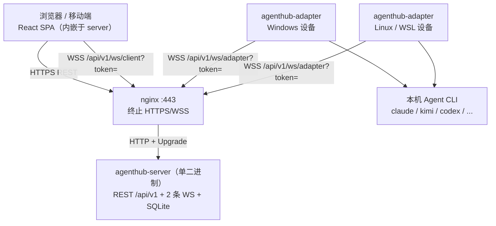

# AgentHub

**一句话定位**：把分散在 Windows / Linux / WSL 多台设备上、协议各异的 AI Agent，集中到一个网页里统一看见、统一注册、统一对话。

平台服务是一个 Go 单二进制（内嵌 Web 前端 + SQLite，无 CGO、无 Redis、无 Docker）；每台设备跑一个独立的 Go 适配器二进制，自动发现本机 agent 并通过 WebSocket 桥接协议。本期只实现「连接注册 + 单 agent 会话」，不实现团队 / 工作区 / 任务派发。

## 1. 架构



- 浏览器 ↔ 平台：`/api/v1/ws/client`（登录 token 走 query，浏览器 WS 不能自定义 header）
- 适配器 ↔ 平台：`/api/v1/ws/adapter`（设备令牌，与登录密码彻底分离）
- 会话恢复标识 `resume_id` **只存平台侧 SQLite**，适配器完全无状态，重启不丢上下文。

## 2. 8 步使用流程（可直接执行）

```bash
# ① 改好正式环境配置
cp config.example.json config.json
openssl rand -hex 32          # 生成 device_token，填入 server.device_token
#   编辑 config.json：server.password（登录密码）、server.domain（绑定域名）、
#   server.device_token、adapter.platform_ws_url（wss://<你的域名>/api/v1/ws/adapter）、
#   adapter.device_token（必须与 server.device_token 完全一致）

# ② 编译：前端 + 5 个纯 Go 交叉编译产物（顺序严格 web → go build）
make build
ls -lh bin/
#   本机快速调试可用：make server adapter

# ③ 公网部署 + nginx 反代
scp bin/agenthub-server-linux-amd64 root@<host>:/opt/agenthub/agenthub-server
scp config.json                    root@<host>:/opt/agenthub/config.json
sudo cp deploy/nginx.conf.example /etc/nginx/conf.d/agenthub.conf
#   改 server_name 与 ssl_certificate / ssl_certificate_key 路径
sudo nginx -t && sudo systemctl reload nginx
cd /opt/agenthub && nohup ./agenthub-server -config config.json > server.log 2>&1 &
curl https://agent-hub.xxxx.com/api/v1/health     # 期望 {"code":0,...,"db":"ok"}

# ④ 每台设备部署连接器（Windows）
scp bin/agenthub-adapter-windows-amd64.exe <设备>:C:/agenthub/adapter.exe
#   同目录写 adapter.json（内容取 config.json 的 adapter 段），然后：
#   PowerShell:  .\adapter.exe -config adapter.json
#   后台:        Start-Process -WindowStyle Hidden .\adapter.exe -ArgumentList "-config","adapter.json"
# Linux / WSL：
scp bin/agenthub-adapter-linux-amd64 <设备>:/opt/agenthub/agenthub-adapter
nohup ./agenthub-adapter -config adapter.json > adapter.log 2>&1 &

# ⑤ 看设备与 agent、加备注
#   浏览器打开 https://<你的域名> → 用 server.password 登录
#   P-2 设备页看设备清单；展开可见该设备上 agent 的版本 / 可执行路径（只读 Q14）
#   「备注 ✎」就地编辑，自动 PATCH 持久化

# ⑥ 勾选注册、看列表
#   P-3 发现与管理页勾选需要的 agent → 「批量注册」→ P-4 列表页出现卡片
#   卡片四要素：名称 / 类型徽标 / 在线状态 / 所属设备

# ⑦ 进入对话收发消息
#   P-4 点击在线卡片 → P-5 输入 → Enter 发送 → 流式增量显示
#   再进可续接上下文；「停止生成」保留已产出内容

# ⑧ 取消注册（二次确认）
#   P-3 已注册行「取消注册」→ 确认弹窗明写「清空会话数据、不可恢复」
#   确认后该 agent 会话清空、卡片消失，设备保持在线，之后可重新注册
```

> 端到端自动验证：`bash scripts/smoke.sh`（一台设备 + 一个假 CLI，跑通注册 → 对话 → 续接 → 取消注册）。

## 3. 配置文件

主推**单文件含 `server` + `adapter` 两段**形态（`config.example.json` 即此形态）。`LoadServerConfig` / `LoadAdapterConfig` 同时兼容「文件本身即单侧对象」，因此部署时也可以把 `server` 段单独存为 `config.json`、`adapter` 段单独存为 `adapter.json`。

| 侧 | 字段 | 默认 / 必填 | 说明 |
| --- | --- | --- | --- |
| server | `password` | **必填** | 网页登录密码，只在服务端配置文件与进程内存，绝不下发前端 / 不进日志 |
| server | `domain` | **必填** | 绑定域名，用于 `/meta` 展示与 nginx `server_name` |
| server | `listen_addr` | `127.0.0.1:8080` | 只监听本机 HTTP，TLS 由 nginx 终止 |
| server | `device_token` | **必填** | 适配器凭据，**与登录密码完全分离**；仅用于 `/api/v1/ws/adapter` 握手 |
| server | `db_path` | `./agenthub.db` | SQLite 单文件，父目录不存在会自动创建 |
| server | `token_ttl_seconds` | `86400` | 登录 token 有效期，不滑动续期，登出即时吊销 |
| server | `heartbeat_timeout_cycles` | `3` | 3×15s=45s 无心跳判离线 |
| server | `log_level` | `info` | slog 级别 |
| server | `protocol_version` | `1` | 握手协商，不匹配返回 5002 / HTTP 426 |
| adapter | `platform_ws_url` | **必填** | `wss://<域名>/api/v1/ws/adapter` |
| adapter | `device_token` | **必填** | 必须与 `server.device_token` 完全一致 |
| adapter | `device_name` | `""` | 留空自动取 `os.Hostname()` |
| adapter | `discover_period_seconds` | `120` | 每 2 分钟重探测全量快照 |
| adapter | `heartbeat_interval_seconds` | `15` | 心跳周期；实际以平台 `register_ack` 下发值为准 |
| adapter | `device_id_path` | `~/.agenthub/device_id` | 设备 id 持久化（重启不变），**不是会话数据** |
| adapter | `agent_paths` | `{}` | PATH 覆盖，见下 |
| adapter | `working_dir` | `""` | **CLI 的工作目录**（同时作为 ACP `session/new` 的 `cwd` 与子进程工作目录）。留空则取适配器进程当前目录；相对路径自动转绝对；**必须是存在的目录**，否则适配器启动即报错。建议显式填一个你希望 Agent 工作的项目目录（kimi 等真实 CLI 会校验 workspace root，空 cwd 会被拒绝） |
| adapter | `turn_timeout_s` | `1800` | 单轮 CLI 生成硬超时（秒）；`0` 表示禁用。超时后适配器 KillTree 回收整棵进程树、平台下发 `5005 GENERATION_TIMEOUT` 并置 `chat.done{interrupted}`，前端提示可重试，避免 CLI 挂死导致该 agent 长期不可用 |
| adapter | `log_level` | `info` | — |

**`agent_paths` 手动指定 CLI 路径**（自动发现找不到时使用，例如 CLI 不在 PATH、或在 WSL 特殊路径）：

```json
{
  "adapter": {
    "agent_paths": {
      "claude": "C:\\Users\\me\\AppData\\Roaming\\npm\\claude.cmd",
      "codex": "/usr/local/bin/codex"
    }
  }
}
```

也支持等价的环境变量 `AGENTHUB_<TYPE>_PATH`（如 `AGENTHUB_CLAUDE_PATH`）。探测四级顺序：配置/环境变量覆盖 → `exec.LookPath`（Windows 按 PATHEXT）→ 登录 shell `command -v`（TTL 30min，指纹 `PATH|SHELL|HOME`）→ 描述符的额外回退路径。命中后执行 `<cmd> --version`（3s 超时，失败填 `unknown`，不影响注册）。

## 4. 本地开发

```bash
# 终端 A：平台服务（监听 127.0.0.1:8080）
cp config.example.json config.json   # 改好 password / device_token
make dev-server

# 终端 B：前端热更新（Vite :5173）
make dev-web
#   vite.config.ts 把 /api 代理到 http://127.0.0.1:8080，并带 ws: true 转发两条 WS 通道
#   浏览器打开 http://127.0.0.1:5173

# 质量门禁
make vet          # CGO_ENABLED=0 go vet ./...
make test         # CGO_ENABLED=0 go test ./... -count=1
make verify       # vet + test + npm run typecheck
```

`make web` 使用独立 npm 缓存目录 `web/.npm-cache`（已加入 `.gitignore`），避免本机全局 npm 缓存损坏导致 `npm ci` 失败。

## 5. 支持的 9 种 Agent 与 4 个协议族

| 类型 | 展示名 | 协议族 | 恢复方式 |
| --- | --- | --- | --- |
| `claude` | Claude Code | S · stream-json | `--resume` |
| `codebuddy` | CodeBuddy | S · stream-json | `--resume` |
| `qwen` | Qwen Code | S · stream-json | `--resume` |
| `cursor` | Cursor Agent | S · stream-json | `--resume` |
| `hermes` | Hermes | A · ACP (JSON-RPC over NDJSON) | `session/resume` |
| `kimi` | Kimi Code | A · ACP | `session/resume` |
| `codex` | Codex | AS · app-server | `thread/resume` |
| `opencode` | OpenCode | J · 行式 JSON | `--session-id` |
| `openclaw` | OpenClaw | J · 整块 JSON + idle grace 2s | `--session-id` |

新增一种 agent 只需在 `internal/adapter/registry.go` 的描述符表加一行；仅当引入新协议族时才需新增解析器。prompt 一律走 stdin 不进 argv；S 族必须收到 `result` 事件才算完成（fail-closed）；openclaw 输出完进程可能长时间不退出，靠 idle grace 提前收尾，绝不 `io.ReadAll` 等 EOF。

## 6. WSL 说明（Q11）

**在 WSL 内单独运行 Linux 版 `agenthub-adapter-linux-amd64`，注册为一台独立设备**。不要从 Windows 适配器跨 `wsl.exe` 驱动 Linux 侧 CLI（进程树清理与路径转换都不可靠）。WSL 内 `runtime.GOOS` 报 `linux`，平台设备页会把它与 Windows 主机区分开。每台设备各自一份 `device_id`（`~/.agenthub/device_id`），重启不变。

## 7. 构建环境要求

| 项 | 要求 | 说明 |
| --- | --- | --- |
| Go | **≥ 1.26** | `go.mod` 声明 `go 1.26.0`（由 `modernc.org/sqlite v1.61.1 → libc v1.79.0` 依赖链强制），低版本无法构建 |
| Node | 22 | Vite 6 + React 18 + TypeScript 5 + Tailwind 3 |
| npm | 10+ | **不用 pnpm**；锁文件 `web/package-lock.json` 必须提交 |
| C 工具链 | 不需要 | 全仓 `CGO_ENABLED=0`，`modernc.org/sqlite` 与 `golang.org/x/sys` 均为纯 Go |

`web/package-lock.json` 的 `resolved` 指向 `registry.npmmirror.com`（国内镜像）。若目标环境只通官方源：

```bash
npm config set registry https://registry.npmjs.org
cd web && rm -rf node_modules package-lock.json && npm install   # 重新生成 lock
```

Windows Git Bash 若提示 `make: command not found`，说明 GNU Make 以 `mingw32-make` 提供：把 `mingw32-make.exe` 复制一份为同目录的 `make.exe`（或 `alias make=mingw32-make`）即可；Makefile 本身是标准 GNU Make 语法，Linux/macOS 直接用 `make`。

## 8. 常见问题

**为什么 `make build` 必须先 `make web`？** `web/embed.go` 用 `//go:embed all:dist` 在**编译期**把 `web/dist` 打进二进制。仓库默认放的是占位页（保证 clone 后不跑前端构建也能 `go build`）；若直接 `go build`，二进制里就是占位页，页面会提示「前端尚未构建」。发布必须 `make build`（web → go build 顺序不可颠倒）。`make clean` 会清掉产物并自动恢复占位页。

**为什么是单二进制？** 前端构建产物被 Go `embed` 内嵌，部署只需 1 个 exe + 1 个 config + 自动创建的 SQLite 文件，不需要独立 Node 进程、Nginx 之外的容器或外部数据库（C-3）。删掉 `web/node_modules` 后仅凭 exe 仍可访问页面。

**无 CGO 怎么落地？** SQLite 用 `modernc.org/sqlite`（C 源码转译为 Go），Windows 进程树清理用 `golang.org/x/sys/windows` 的纯 Go syscall 封装（Job Object + `KILL_ON_JOB_CLOSE`），全部产物 `CGO_ENABLED=0`，可交叉编译 5 个目标而无需目标平台 C 工具链。`go list -deps ./...` 中不含 `runtime/cgo`。

**日志会泄露凭据吗？** 不会。`log/slog` JSON handler，脱敏铁律：不打印 password / device_token / token 全文（只打前 6 位 + `***`）、不打印 prompt 全文（只打长度）、不打印完整 WS URL。nginx 侧配了去掉 `$args` 的 `log_format`，避免 `?token=` 落盘（见 `deploy/nginx.conf.example`）。

**设备离线了怎么办？** 适配器断线按 1s→30s 指数退避重连，重连后立即重发全量快照对账；平台 45s 无心跳置离线并广播 `agent.status`，恢复连接自动变回在线，无需刷新页面。离线时发送按钮禁用，后端返回 `3003`。

## 9. 文档索引

| 文档 | 内容 |
| --- | --- |
| [openapi.yaml](docs/openapi.yaml) | OpenAPI 3.0.3，14 个 REST paths / E01~E15 |
| [nginx 样例](deploy/nginx.conf.example) | 443/TLS、WSS Upgrade、日志脱敏 |
| [冒烟脚本](scripts/smoke.sh) | 端到端：注册 → 对话 → 续接 → 取消注册清空 |
